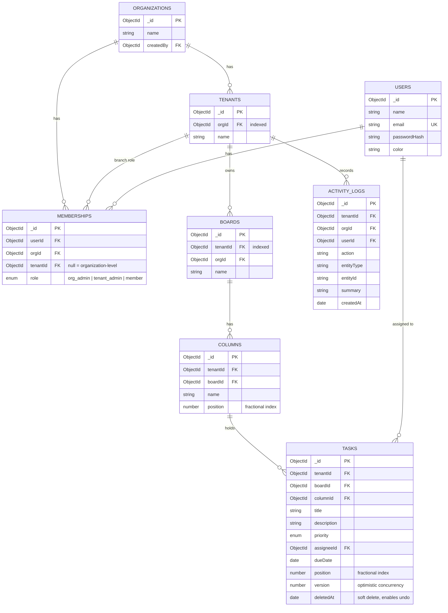

# Database schema (MongoDB / Mongoose)

GitHub renders the diagram below.

## Indexes

| Collection | Index | Why |
|---|---|---|
| memberships | unique `(userId, orgId, tenantId)` | one role per user per scope |
| memberships | `(tenantId)` | list a tenant's people |
| boards | `(tenantId)` | list boards of a tenant |
| columns | `(tenantId, boardId, position)` | ordered columns |
| tasks | `(tenantId, columnId, position)` | ordered cards, neighbour lookups for moves |
| tasks | `(tenantId, boardId, deletedAt)` | board snapshot |
| activity_logs | `(tenantId, createdAt desc)` | newest-first feed |

## Isolation rule

`boards`, `columns`, `tasks` and `activity_logs` all carry `tenantId`, and no query is ever issued without it.
